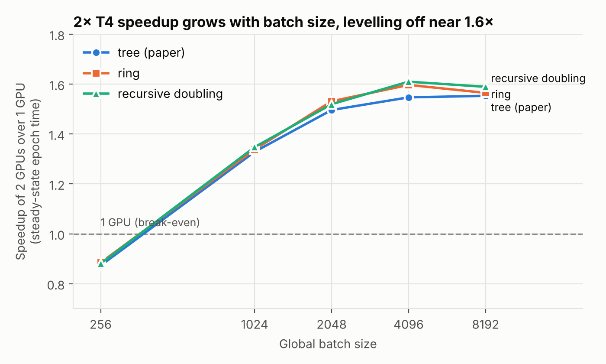
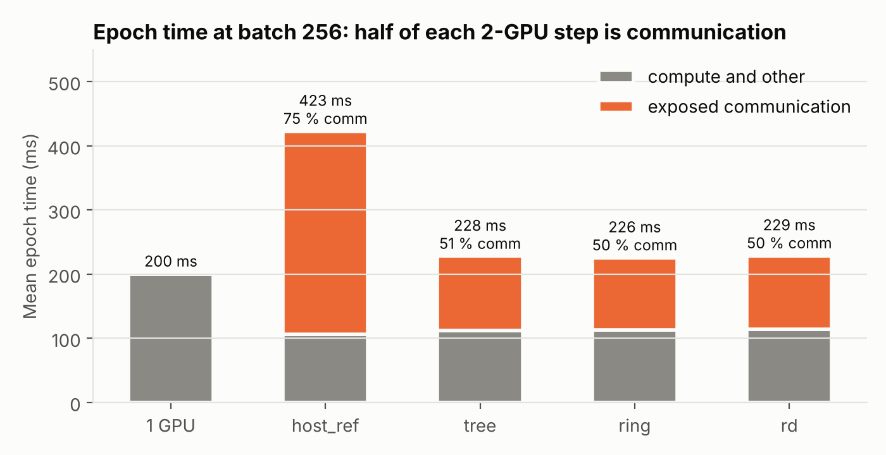
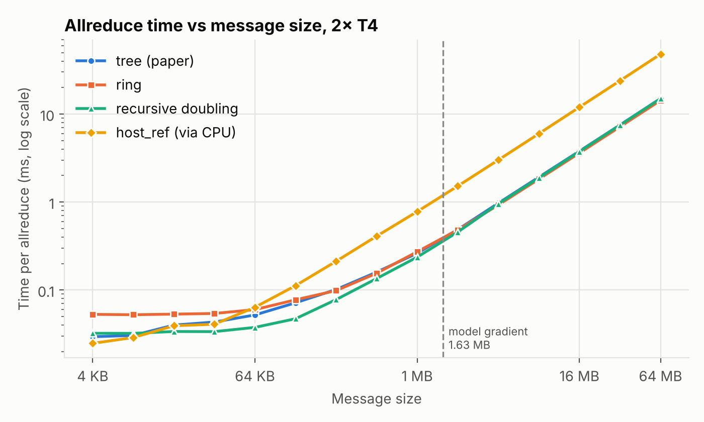
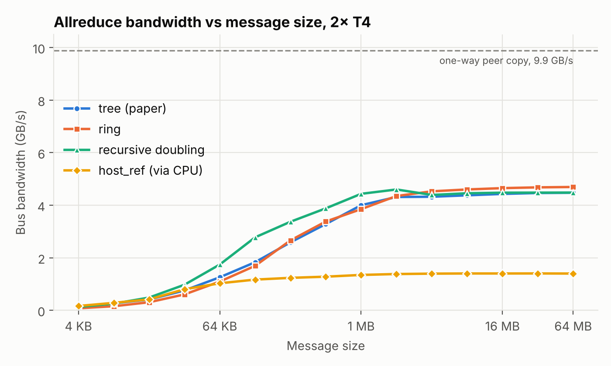
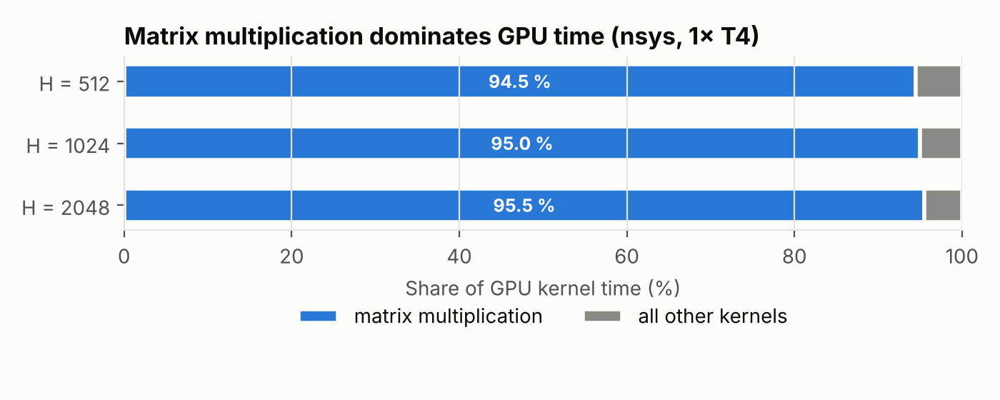

# SGD song song dữ liệu trên CUDA với allreduce tự cài đặt: kết quả

_English version: [README.en.md](README.en.md)_

Đề tài 10 (Tối ưu truyền thông đa GPU), dựa trên Hegde & Usmani, *Parallel and Distributed Deep
Learning* (Stanford). Mạng MLP được huấn luyện trên MNIST bằng SGD song song dữ liệu đồng bộ trên
k GPU; gradient được lấy trung bình bằng các thuật toán allreduce tự viết (không dùng NCCL, cuBLAS
hay MPI). Bài báo chỉ phân tích chi phí truyền thông (O(L·k) + O(k·p/B)) về mặt lý thuyết; đề tài
này đo nó trên thực tế.

Mọi số liệu đo trên Kaggle, 2× Tesla T4, với thiết lập cố định (10 epoch) và lặp 3 lần mỗi cấu hình,
build từ chính repo này (commit 3fd2b8a). Kết quả và CSV gốc:
[`runs/kaggle-final-2026-11-22/`](runs/kaggle-final-2026-11-22/) (huấn luyện và allreduce, kèm
[`summary.md`](runs/kaggle-final-2026-11-22/summary.md)) và
[`runs/kaggle-profile-2026-11-22/`](runs/kaggle-profile-2026-11-22/) (profile kernel) và
[`runs/kaggle-sweep-2026-11-23/`](runs/kaggle-sweep-2026-11-23/) (quét kích thước batch). Lần chạy
2 epoch trước đó được giữ trong [`runs/kaggle-2026-11-22/`](runs/kaggle-2026-11-22/).

## Tóm tắt

| Câu hỏi | Trả lời |
|---|---|
| Các thuật toán allreduce trên GPU có đúng không? | Có. tree, ring và rd qua mọi bài kiểm tra; các bản sao tham số giống nhau từng bit; qua 10 epoch, loss chênh lệch không quá 2e-5 so với 1 GPU; độ chính xác 96,14 % (1 GPU và CPU: 96,16 %). |
| GPU có nhanh hơn CPU khi huấn luyện không? | Có. 1 T4: 0,199 s/epoch; bản C tuần tự trên một nhân CPU: 8,19 s. Nhanh khoảng **41 lần**. |
| Phép nhân ma trận có phải nút thắt cổ chai không? | Có. Chiếm 99,7 % số FLOP và **94,5–95,5 % thời gian kernel trên GPU** (đo bằng nsys). |
| Truyền thông tốn bao nhiêu? | Khoảng **một nửa mỗi bước khi dùng 2 GPU** (50–51 % truyền thông không được che) với tree, ring và rd; 75 % nếu đi qua CPU. Một lần allreduce gradient 1,63 MB mất 0,36–0,39 ms trên GPU, 1,19 ms qua CPU. |
| 2 GPU có nhanh hơn 1 GPU không? | Tùy kích thước batch. Với batch mặc định 256 thì không: 0,87–0,89 lần, vì truyền thông tốn gần bằng phần tính toán tiết kiệm được khi chia batch. Từ batch 1024 trở lên thì có: 1,33 lần ở 1024, 1,53 lần ở 2048 và tới **1,60 lần** ở 4096 (mục 6). |
| Thuật toán allreduce nào nhanh nhất? | Trong benchmark: host_ref ở 4–8 KB, recursive doubling từ 16 KB đến 2 MB, ring từ 4 MB trở lên. Khi huấn luyện, tree, ring và rd chênh nhau dưới 2 % và khoảng giá trị qua các lần lặp chồng lên nhau, nên không có thuật toán nào thắng. |

## Biểu đồ

Vẽ từ các file CSV trong `runs/` bằng `python3 scripts/make_figures.py` (nhãn trong hình bằng tiếng Anh).

| | |
|---|---|
|  |  |
|  |  |
|  | |

## Cấu hình thí nghiệm

| Mục | Giá trị |
|---|---|
| Phần cứng | Kaggle, 2× Tesla T4 (70 W, sm_75), driver 580.178, CUDA 13.0 |
| Kết nối | PCIe qua host bridge (topology PHB) |
| Mô hình | MLP 784–512–10, 407.050 tham số (gradient 1,63 MB fp32) |
| Huấn luyện | seed 42, batch toàn cục 256 (128 mỗi GPU khi k = 2), lr 0,1, 10 epoch, lặp 3 lần mỗi cấu hình (báo cáo trung vị) |
| Benchmark | 4 KB đến 64 MB, 5 lần khởi động + 20 lần đo, lấy trung vị; busbw = bytes/time × 2(k−1)/k |

Các phương pháp (mỗi phương pháp một file trong `src/allreduce/`):

| Phương pháp | Cách hoạt động |
|---|---|
| `host_ref` | Chép mọi gradient về CPU, lấy trung bình, chép ngược lên GPU. Dùng làm chuẩn để kiểm tra tính đúng |
| `tree` | Phương pháp của bài báo: gom (reduce) về GPU 0, lấy trung bình, phát (broadcast) lại |
| `ring` | Reduce-scatter rồi allgather (chưa chia nhỏ khối để pipeline) |
| `rd` | Recursive doubling; GPU dư được gộp vào khi k không phải lũy thừa của 2 |
| `--overlap` | Bắt đầu allreduce gradient lớp 2 trong khi lan truyền ngược của lớp 1 vẫn đang chạy |

## 1. Tính đúng đắn

| Kiểm tra | host_ref | tree | ring | rd |
|---|---|---|---|---|
| `make simcheck` (CUDA giả lập, thứ tự stream ngẫu nhiên, k = 2..8; 5.670 lần chạy) | không áp dụng | đạt | đạt | đạt |
| `bench_allreduce --check-only`, mọi kích thước kể cả n lẻ | đạt | đạt | đạt | đạt |
| Sai khác tham số lớn nhất giữa các bản sao | 0 (từng bit) | 0 (từng bit) | 0 (từng bit) | 0 (từng bit) |
| Loss so với 1 GPU qua 10 epoch, sai khác tuyệt đối lớn nhất | 2e-5 | 2e-5 | 2e-5 | 2e-5 |
| Độ chính xác trên tập test, 10 epoch | 96,14 % | 96,14 % | 96,14 % | 96,14 % |

1 GPU và bản C tuần tự đều đạt 96,16 % (sai khác loss lớn nhất 1e-5). Chênh lệch 0,02 điểm trên
2 GPU là do cộng gradient theo thứ tự khác, làm sai số làm tròn số thực khác đi.

## 2. GPU so với CPU

| Phiên bản | Thời gian mỗi epoch (ổn định) | Tăng tốc |
|---|---|---|
| C tuần tự, một nhân CPU (`mlp_seq`) | 8,19 s | 1× |
| 1× T4 (`train_dp --gpus 1`), trung vị 3 lần chạy | 0,199 s | ~41× |

Cả hai có cùng đường loss và cùng độ chính xác 96,16 %.

## 3. Phép nhân ma trận là nút thắt tính toán

Mô hình là MLP, nhưng một lớp kết nối đầy đủ chính là một phép nhân ma trận, và một lớp tích chập
sau khi biến đổi im2col cũng trở thành một phép nhân ma trận, nên lập luận này áp dụng được cho CNN.

**Đếm FLOP** (`scripts/flops.py`, H = 512, batch 256): năm phép nhân ma trận mỗi bước tốn
418,9 MFLOP; mọi phần còn lại (bias + ReLU, softmax, ReLU ngược, gradient bias, cập nhật SGD) chỉ
1,4 MFLOP. Nhân ma trận chiếm **99,7 % số FLOP**, ở mọi kích thước lớp ẩn. Để so sánh, một lớp tích
chập 3×3 từ 32 lên 64 kênh trên ảnh 28×28 là phép nhân (784×288)·(288×64), tức 28,9 MFLOP mỗi ảnh.

**Thời gian đo được** (nsys, một epoch trên 1 T4, [`kernel_share.csv`](runs/kaggle-profile-2026-11-22/kernel_share.csv)):

| Kernel | H = 512 | H = 1024 | H = 2048 |
|---|---|---|---|
| `k_matmul_tiled` | **94,5 %** | **95,0 %** | **95,5 %** |
| `k_sgd` | 1,6 % | 2,4 % | 2,5 % |
| `k_colsum` | 1,8 % | 0,9 % | 0,5 % |
| `k_bias_relu` | 0,9 % | 0,8 % | 0,8 % |
| `k_softmax_xent` | 0,8 % | 0,5 % | 0,2 % |
| `k_relu_backward` | 0,4 % | 0,4 % | 0,5 % |
| Tổng thời gian kernel | 220,7 ms | 368,1 ms | 715,2 ms |

Tỉ lệ thời gian thấp hơn tỉ lệ FLOP một chút vì các kernel theo từng phần tử bị giới hạn bởi băng
thông bộ nhớ: chúng gần như không tính toán nhưng vẫn phải đọc và ghi mọi phần tử. Kernel nhân ma
trận thực hiện khoảng 106 GFLOP mỗi epoch (huấn luyện cộng lan truyền thuận trên tập test) trong
208,5 ms thời gian kernel, tức khoảng 510 GFLOP/s, chỉ 6 % hiệu năng FP32 đỉnh của T4, nên tăng tốc
phép nhân ma trận sẽ giảm trực tiếp phần tính toán của mỗi bước.

## 4. Chi phí truyền thông và tăng tốc trên 2 GPU

`train_dp` báo thời gian mỗi epoch và tỉ lệ truyền thông không được che (từ lúc kết thúc lan truyền
ngược đến lúc allreduce xong trên GPU 0) trong mỗi bước. Trung vị 3 lần chạy, khoảng min–max trong
ngoặc; "ổn định" = trung vị các epoch 2–10 (epoch 1 có thời gian khởi động):

| Cấu hình | Epoch ổn định (s) | Tăng tốc so với 1 GPU | Truyền thông không được che |
|---|---|---|---|
| 1 GPU | 0,199 (0,199–0,200) | 1,00× | 0,5 % |
| host_ref | 0,420 (0,420–0,420) | 0,47× | 74,9 % |
| host_ref + overlap | 0,433 (0,431–0,436) | 0,46× | 71,6 % |
| tree | 0,225 (0,225–0,227) | 0,88× | 50,9 % |
| tree + overlap | 0,227 (0,226–0,227) | 0,88× | 50,4 % |
| ring | 0,225 (0,223–0,225) | 0,88× | 49,8 % |
| ring + overlap | 0,227 (0,226–0,228) | 0,88× | 50,9 % |
| rd | 0,228 (0,224–0,229) | 0,87× | 50,1 % |
| rd + overlap | 0,224 (0,224–0,225) | 0,89× | 49,7 % |

Nhận xét:

- Khoảng một nửa mỗi bước 2 GPU là truyền thông. Trong benchmark (mục 5), một lần allreduce
  gradient 1,63 MB mất 0,36–0,39 ms trên GPU, nên truyền thông tốn gần bằng phần tính toán tiết
  kiệm được khi chia batch, và 2 GPU chậm hơn 1 GPU khoảng 12 %.
- Thực hiện phép gom trên GPU thay vì CPU giảm một nửa thời gian mỗi epoch (0,420 s xuống
  0,225 s) và giảm truyền thông không được che từ 75 % xuống khoảng 50 %. Allreduce 1,63 MB qua
  CPU mất 1,19 ms, gấp ba lần các phương pháp trên GPU.
- Khi huấn luyện, tree, ring và rd chênh nhau dưới 2 % và khoảng giá trị qua 3 lần lặp chồng lên
  nhau, nên số đo không xếp hạng được chúng ở kích thước thông điệp này.
- `--overlap` không tạo khác biệt đo được (trong khoảng ±1 %); MLP hai lớp còn quá ít việc lan
  truyền ngược để che truyền thông.
- Các lần lặp rất ổn định: 3 lần chạy của mỗi cấu hình chênh nhau tối đa 2 %.

## 5. Allreduce thuần: thuật toán nào thắng ở kích thước nào

Thời gian trung vị mỗi lần allreduce, k = 2, ms ([`allreduce.csv`](runs/kaggle-final-2026-11-22/allreduce.csv)); chữ đậm là nhanh nhất:

| Kích thước | host_ref | tree | ring | rd |
|---|---|---|---|---|
| 4 KB | **0,025** | 0,029 | 0,053 | 0,032 |
| 8 KB | **0,029** | 0,030 | 0,052 | 0,032 |
| 16 KB | 0,039 | 0,040 | 0,053 | **0,034** |
| 64 KB | 0,064 | 0,052 | 0,060 | **0,038** |
| 256 KB | 0,212 | 0,101 | 0,098 | **0,078** |
| 1 MB | 0,779 | 0,262 | 0,272 | **0,237** |
| 2 MB | 1,518 | 0,486 | 0,482 | **0,456** |
| 4 MB | 3,005 | 0,970 | **0,926** | 0,955 |
| 16 MB | 11,970 | 3,787 | **3,608** | 3,747 |
| 64 MB | 47,980 | 15,001 | **14,298** | 14,979 |

Băng thông bus ở 64 MB: host_ref 1,40, tree 4,47, ring 4,69, rd 4,48 GB/s. Một lần chép P2P một
chiều đạt 9,9 GB/s (`runs/kaggle-2026-11-22/`).

- **Thông điệp nhỏ bị giới hạn bởi độ trễ.** Với 4–8 KB, hai lần chép nhỏ qua CPU nhanh hơn một chút
  so với mọi phương pháp trên GPU. Ring có mức sàn khoảng 0,053 ms vì phải chạy nhiều bước phụ thuộc
  nhau; tree và rd bắt đầu từ khoảng 0,029–0,034 ms.
- **Thông điệp vừa (16 KB–2 MB) thì recursive doubling nhanh nhất**, hơn tới 30 % ở 64 KB và 5–10 %
  ở 1–2 MB. Gradient 1,63 MB của mô hình nằm trong khoảng này.
- **Thông điệp lớn bị giới hạn bởi băng thông và ring nhanh nhất**, nhưng chỉ hơn 4–5 %. Đường qua
  CPU chậm hơn các phương pháp GPU 3,3 lần ở đây (1,4 so với 4,5–4,7 GB/s).
- **Các phương pháp GPU chỉ đạt khoảng một nửa tốc độ đường truyền.** Tree phải gửi dữ liệu đi một
  chiều rồi gửi về, nên một nửa là giới hạn của nó. Ring và rd về lý thuyết có thể dùng cả hai chiều
  cùng lúc nhưng không vượt được mức đó, cho thấy hai chiều không chạy chồng lên nhau và ring cần
  pipeline theo khối.
- **Lặp lại được.** Số liệu khớp với lần chạy 2 epoch trước đó trên một máy Kaggle khác, sai khác
  dưới 0,3 % với thông điệp từ 4 MB trở lên và dưới 9 % với thông điệp nhỏ.
- Với k = 2, ba thuật toán GPU truyền cùng một lượng dữ liệu. Khác biệt lý thuyết giữa chúng chỉ thể
  hiện khi k ≥ 4.

## 6. Khi nào 2 GPU có lợi? Quét kích thước batch

Gradient luôn là 1,63 MB nên chi phí truyền thông mỗi bước cố định (khoảng 0,4 ms), trong khi phần
tính toán mỗi bước tăng theo batch. Vì vậy batch toàn cục càng lớn thì tỉ lệ thời gian dành cho
truyền thông càng nhỏ. Quét trên 2× T4, 5 epoch, lặp 3 lần, thời gian epoch ổn định
([`runs/kaggle-sweep-2026-11-23/`](runs/kaggle-sweep-2026-11-23/summary.md)):

| Batch toàn cục | 1 GPU, thời gian mỗi bước (ms) | Tăng tốc, tree | Tăng tốc, ring | Tăng tốc, rd | Truyền thông không được che, tree / ring / rd |
|---|---|---|---|---|---|
| 256 | 0,85 | 0,87× | 0,88× | 0,88× | 54 / 50 / 50 % |
| 1024 | 3,27 | 1,33× | 1,33× | 1,34× | 36 / 22 / 23 % |
| 2048 | 6,76 | 1,50× | 1,53× | 1,53× | 27 / 13 / 13 % |
| 4096 | 14,11 | 1,55× | 1,59× | **1,60×** | 22 / 7 / 7 % |
| 8192 | 29,29 | 1,55× | 1,57× | 1,59× | 21 / 5 / 5 % |

- **Điểm hòa vốn nằm giữa 256 và 1024.** Dưới đó, truyền thông lớn hơn phần tính toán tiết kiệm được;
  trên đó, 2 GPU thắng và tăng tốc bão hòa ở khoảng 1,6 lần.
- **Vì sao không đạt 2 lần.** Truyền thông trở nên nhỏ (5–7 % với ring và rd), nhưng mỗi bước vẫn
  phải gom cả batch toàn cục trên host và chép lên GPU, và phần đó không giảm khi thêm GPU (định luật
  Amdahl).
- **Ring và rd nhanh hơn tree khi tính toán chiếm ưu thế.** Ở batch 256 cả ba ngang nhau. Từ 1024 trở
  lên, tree có thời gian truyền thông không được che gấp 3–4 lần (21–36 % so với 5–23 %) và chậm hơn
  2–4 %. Tree dồn công việc lên GPU 0 (nhận, cộng, chia, gửi lại), còn ring và rd chia đều cho cả hai
  GPU. Nguyên nhân chính xác của phần thời gian thêm của tree chưa được tách riêng.
- **Khớp với bài báo.** Hegde & Usmani (mục 3.2, hình 2) cũng thấy tăng tốc tăng theo kích thước batch.
- **Đánh đổi: độ chính xác sau cùng số epoch giảm** khi batch lớn với learning rate cố định (94,7 % ở
  256, 85,2 % ở 8192 sau 5 epoch), vì số lần cập nhật mỗi epoch ít hơn. Phép quét đo tốc độ, không
  tìm batch tốt nhất cho độ chính xác.
- Khi tải nặng hơn, T4 chạm giới hạn công suất thường hơn (31 trên 91 mẫu ở GPU 0), nhưng xung SM
  trung vị vẫn ở mức tối đa 1.590 MHz.

## Hạn chế

- **Chỉ có 2 GPU.** Kaggle cung cấp tối đa 2× T4, nên không kiểm chứng được sự tăng theo k của
  O(L·k) + O(k·p/B).
- **Mô hình nhỏ.** Với gradient 1,63 MB và dưới 1 ms tính toán mỗi bước ở batch mặc định, truyền
  thông chiếm ưu thế. Phép quét batch (mục 6) cho thấy tăng tốc khi phần tính toán mỗi bước lớn lên;
  batch lớn hơn làm giảm độ chính xác sau cùng số epoch với learning rate cố định.
- **Truy cập P2P khác nhau giữa các máy Kaggle.** Có máy Kaggle 2× T4 có truy cập P2P, có máy không;
  khi không có, việc chép giữa GPU phải đi qua bộ nhớ host và số liệu không so sánh được. Luôn ghi
  lại ma trận P2P cùng kết quả (job đã tự ghi).
- **Xung nhịp T4 được kiểm tra, không được cố định.** Khi có tải, xung SM giữ ở mức tối đa 1.590 MHz
  (trung vị) trên cả hai GPU, công suất trung vị 48 W, nhiệt độ tối đa 82 °C. Driver báo chạm giới
  hạn công suất ở 5 trên 105 mẫu có tải của GPU 0 và không lần nào ở GPU 1, nên việc hạ xung ảnh
  hưởng rất ít.

## Build và chạy

```bash
make data          # tải MNIST vào ./data
make seq           # bản C tuần tự (chỉ cần gcc)
make ARCH=sm_75    # build tất cả; sm_75 = T4, sm_80 = A100
make simcheck      # kiểm tra tree/ring/rd với thứ tự stream ngẫu nhiên (chỉ cần g++, không cần GPU)

./bin/mlp_seq                                     # bản tuần tự (CPU)
./bin/train_dp --gpus 1                           # 1 GPU
./bin/train_dp --gpus 2 --method ring [--overlap] # song song dữ liệu
./bin/bench_allreduce --method ring --gpus 2 [--check-only]
bash scripts/run_experiments.sh 2 "tree ring rd"  # so sánh đầy đủ
python3 scripts/flops.py --hidden 512             # đếm FLOP, nhân ma trận so với phần còn lại
```

Trên Kaggle (điền username vào `kernel-metadata.json` trước):

```bash
kaggle kernels push -p scripts/kaggle/check --accelerator NvidiaTeslaT4    # build, kiểm tra, huấn luyện, benchmark
kaggle kernels push -p scripts/kaggle/profile --accelerator NvidiaTeslaT4  # profile thời gian kernel bằng nsys
kaggle kernels push -p scripts/kaggle/final --accelerator NvidiaTeslaT4    # lần chạy cuối: 10 epoch x 3 lần, ghi xung nhịp
python3 scripts/summarize_runs.py results/final.log results/clocks.csv     # bảng trung vị từ lần chạy đó
kaggle kernels push -p scripts/kaggle/sweep --accelerator NvidiaTeslaT4    # quét batch, 1 so với 2 GPU
```

Các thiết lập cố định nằm trong `src/common/config.h`. Mọi file CSV có cùng các cột:
`method,k,msg_bytes,time_ms,busbw_GBs,epoch_s,comm_pct,test_acc` (`-1` = không áp dụng;
`comm_pct` = truyền thông không được che, tính theo % thời gian bước).

## Cấu trúc thư mục

```
src/
  common/     config.h (thiết lập cố định), đọc MNIST, tham số/CLI, timer, CSV
  seq/        mlp_seq.c: MLP tuần tự bằng C (chuẩn kiểm tra tính đúng)
  cuda/       kernels.cu (nhân ma trận dạng tile, softmax, relu, ...), train_dp.cu (vòng huấn luyện)
  allreduce/  allreduce.h (giao diện), ar_sync.h, common.cu, registry.cu, mỗi phương pháp một file
bench/        bench_allreduce.cu: kiểm tra tính đúng + đo độ trễ/băng thông
tests/        sim_allreduce.cpp + CUDA runtime giả lập (make simcheck)
scripts/      run_experiments.sh, flops.py, kernel_share.py, summarize_runs.py, summarize_sweep.py, get_mnist.sh
  kaggle/     check/ (kiểm tra nhanh), profile/ (profile kernel bằng nsys), final/ (lần chạy cuối), sweep/ (quét batch)
runs/         log và CSV gốc từ Kaggle
```
